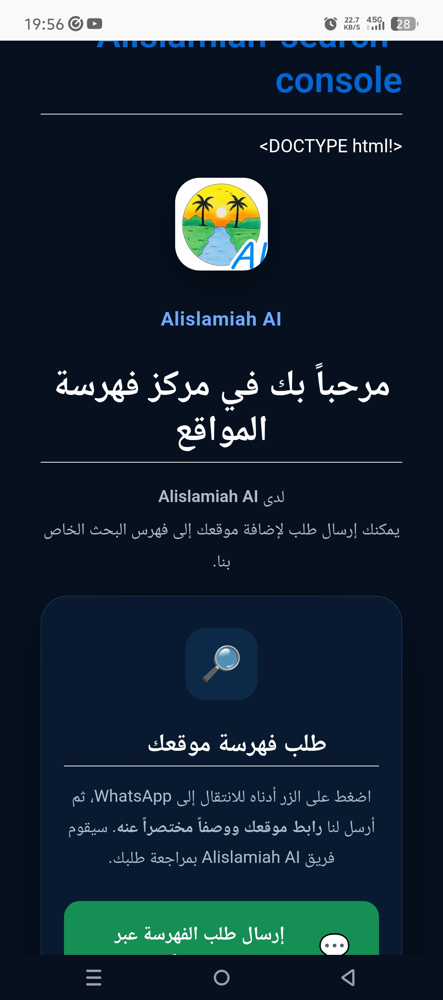
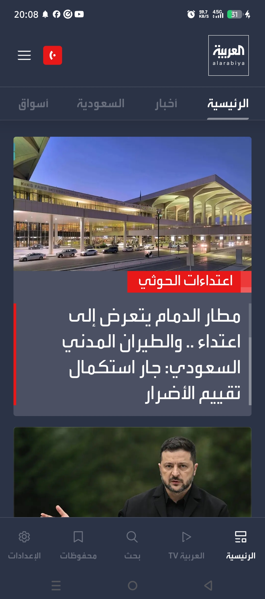

<!DOCTYPE html>
<html lang="ar" dir="rtl">
<head>
    <meta charset="UTF-8">
    <meta name="viewport" content="width=device-width, initial-scale=1.0, maximum-scale=1.0, user-scalable=no">
    <title>Bing</title>
    <link rel="icon" href="icon.png" type="image/png">
    <link rel="apple-touch-icon" href="icon.png">
    
</head>
<body>
    <!-- الشاشة الترحيبية -->
    

        

        

            

            <rect width=\'100\' height=\'100\' rx=\'25\' fill=\'%23087fff\'/><text x=\'50\' y=\'68\' font-size=\'55\' font-weight=\'bold\' text-anchor=\'middle\' fill=\'white\'>B</text></svg>'">
        

        
Alislamiah Bing

    

    

    <!-- شريط الحالة -->
    

        01:05
        

            58.1 KB/s
            4G
            21
            ⚡
        

    

    <!-- أيقونة الحساب -->
    

        

            
            <svg class="default-icon" style="display:none;" viewBox="0 0 24 24">
                <path d="M12 12c2.21 0 4-1.79 4-4s-1.79-4-4-4-4 1.79-4 4 1.79 4 4 4zm0 2c-2.67 0-8 1.34-8 4v2h16v-2c0-2.66-5.33-4-8-4z"/>
            </svg>
        

    

    <!-- المحتوى الرئيسي -->
    

        <!-- شريط البحث -->
        <form class="search-box" action="results_full.html" method="GET" id="searchForm">
            <svg class="search-icon" viewBox="0 0 24 24">
                <path d="M15.5 14h-.79l-.28-.27A6.471 6.471 0 0 0 16 9.5 6.5 6.5 0 1 0 9.5 16c1.61 0 3.09-.59 4.23-1.57l.27.28v.79l5 4.99L20.49 19l-4.99-5zm-6 0C7.01 14 5 11.99 5 9.5S7.01 5 9.5 5 14 7.01 14 9.5 11.99 14 9.5 14z"/>
            </svg>
            <input type="text" name="q" class="search-input" placeholder="Search" autocomplete="off" autofocus>
            

                <svg class="action-btn" viewBox="0 0 24 24" onclick="alert('الكاميرا')">
                    <path d="M12 15.2c1.76 0 3.2-1.44 3.2-3.2s-1.44-3.2-3.2-3.2-3.2 1.44-3.2 3.2 1.44 3.2 3.2 3.2zm0-8c2.65 0 4.8 2.15 4.8 4.8s-2.15 4.8-4.8 4.8-4.8-2.15-4.8-4.8 2.15-4.8 4.8-4.8zm8.4-2H18l-1.2-1.6c-.3-.4-.8-.6-1.3-.6H8.5c-.5 0-1 .2-1.3.6L6 5.2H3.6C2.7 5.2 2 5.9 2 6.8v12.4c0 .9.7 1.6 1.6 1.6h16.8c.9 0 1.6-.7 1.6-1.6V6.8c0-.9-.7-1.6-1.6-1.6z"/>
                </svg>
                <svg class="action-btn" viewBox="0 0 24 24" onclick="alert('الميكروفون')">
                    <path d="M12 14c1.66 0 3-1.34 3-3V5c0-1.66-1.34-3-3-3S9 3.34 9 5v6c0 1.66 1.34 3 3 3zm-1-9c0-.55.45-1 1-1s1 .45 1 1v6c0 .55-.45 1-1 1s-1-.45-1-1V5zm6 6c0 2.76-2.24 5-5 5s-5-2.24-5-5H5c0 3.53 2.61 6.43 6 6.92V21h2v-3.08c3.39-.49 6-3.39 6-6.92h-2z"/>
                </svg>
            

        </form>

        <!-- البطاقات -->
        

            <a href="https://mohamedmadoui5195.github.io/Alislamiah-search-console/" class="card" style="text-decoration:none;color:inherit;">
                
Alislamiah Search

                

                    Search Console
                    
                

            </a>
            <a href="https://mohamedmadoui5195.github.io/Alislamiah-services/" class="card" style="text-decoration:none;color:inherit;">
                
Alislamiah Services

                

                    الخدمات
                    
                

            </a>
            <a href="https://mohamedmadoui5195.github.io/Alislamiah-_net/" class="card" style="text-decoration:none;color:inherit;">
                
Alislamiah Net

                

                    الشبكة
                    
                

            </a>
        

    

<!-- البطاقة الأولى -->

  مادة إعلانية
  
  

    <h2 class="ad-card-title">مداد</h2>
    
أقوى منصة لصنع الألعاب والمواقع والبرامج، حول أفكارك إلى واقع

    <a href="https://nazim10-u.github.io/nazim/" class="ad-card-btn" target="_blank">زيارة الموقع</a>
  

<!-- البطاقة الثانية -->

  مادة إعلانية
  
  

    <h2 class="ad-card-title">alarabiya.net</h2>
    
تابعوا الأخبار العربية والعالمية هنا

    <a href="https://www.alarabiya.net" class="ad-card-btn green" target="_blank">زيارة الموقع</a>
  

<!-- البطاقة الثالثة -->

  مادة إعلانية
  
  

    <h2 class="ad-card-title">Alislamiah search console</h2>
    
آداة مشرفي المواقع... إن كان لديك موقع أطلب هنا لكي نفهرسه لك ويظهر في نتائج البحث

    <a href="https://mohamedmadoui5195.github.io/Alislamiah-search-console/" class="ad-card-btn purple" target="_blank">زيارة الموقع</a>
  

    <!-- شريط التنقل السفلي -->
    <nav class="bottom-nav">
        <a href="index.html" class="nav-item active">
            
🏠

            البحث
        </a>
        <a href="results_full.html" class="nav-item">
            
🔍

            بحث
        </a>
        <a href="https://mohamedmadoui5195.github.io/Gemalot/" class="nav-item">
            

                
G

            

            Gemalot
        </a>
    </nav>

    
</body>
</html>
